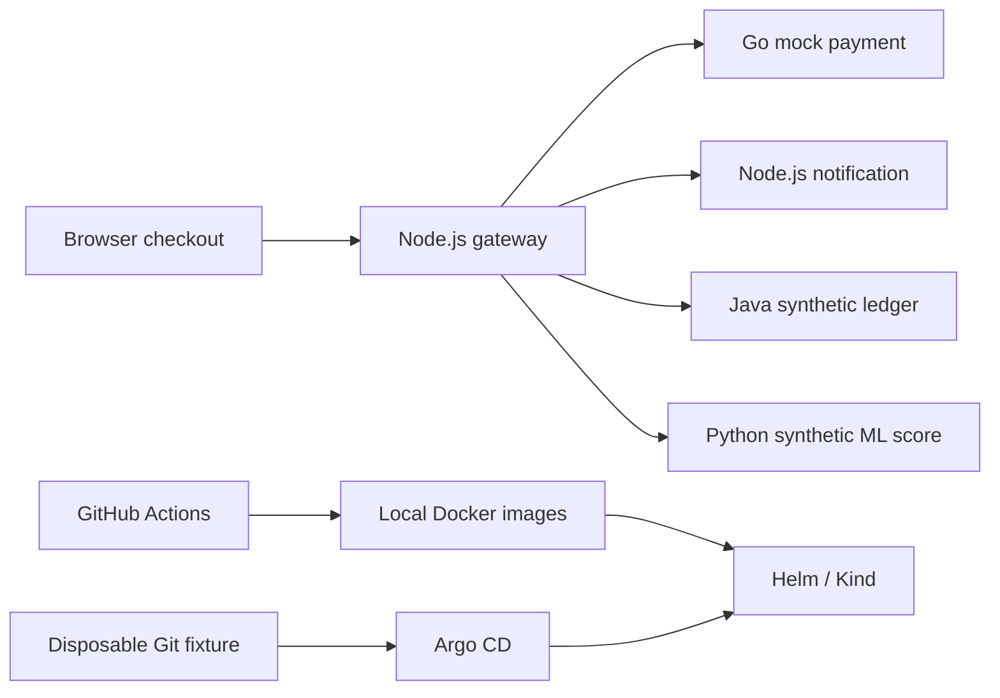

# Synthetic FinTech Platform | Local DevSecOps Integration

An independent local-first microservices lab inspired by the bootcamp architecture. The checkout gateway serves a demo UI, coordinates a Go mock payment service, sends an in-memory notification event, reads an independent synthetic Java ledger, and requests an educational Python fraud score. No actual money, customer records, email, payment rails or private training code are used.



## Reproducible checkout

Clone the repositories as siblings. The pinned revisions are independently implemented portfolio sources and are also checked out by CI:

```bash
git clone https://github.com/bckish/devsecops-eks-jenkins-argocd.git
git clone https://github.com/bckish/java-cicd-kubernetes.git
git -C java-cicd-kubernetes checkout fc233e8a615c3117a1766023b4d3b268c5c01492
git clone https://github.com/bckish/Fundamentals-of-MLOps.git
git -C Fundamentals-of-MLOps checkout fea14d46e374f02bc9a2539543f74110dbc17e15
cd devsecops-eks-jenkins-argocd
docker compose -p fintech-demo up -d --build
python3 scripts/smoke.py
```

Open `http://127.0.0.1:18087`. Use only synthetic IDs starting with `demo-` and integer cents. Stop the disposable local stack with `docker compose -p fintech-demo down -v`.

The mock payment and notification stores are process-local and bounded. They are not durable or transactional across replicas; keep one replica of each. The synthetic score is informational, not a payment decision; the ledger is read-only and does not record a payment. The UI is plain HTML/JavaScript, not the future React/TypeScript CDN exercise.

## Kubernetes and GitOps (local only)

Create a dedicated cluster, load all five locally built images (`fintech-payment:local`, `fintech-notification:local`, `fintech-checkout:local`, `java-ledger:local`, `synthetic-fraud:local`), and deploy the chart:

```bash
kind create cluster --name fintech-lab --image kindest/node:v1.34.3 --kubeconfig ./fintech-lab.kubeconfig
kind load docker-image --name fintech-lab fintech-payment:local fintech-notification:local fintech-checkout:local java-ledger:local synthetic-fraud:local
helm --kubeconfig ./fintech-lab.kubeconfig upgrade --install fintech chart --namespace fintech-lab --create-namespace --wait
kubectl --kubeconfig ./fintech-lab.kubeconfig -n fintech-lab port-forward --address 127.0.0.1 svc/checkout 18087:8080
```

If multi-platform import fails on Apple Silicon, use `docker image save --platform linux/arm64 -o fintech.tar` with the same five images and `kind load image-archive --name fintech-lab fintech.tar`. The local chart creates only ClusterIP services and uses non-root containers, probes, resource limits, read-only filesystem and dropped capabilities. The Java temporary directory is a bounded ephemeral volume.

For the disposable Argo CD demonstration, build a read-only Git fixture from the chart with two revisions, load its image, then install the pinned Argo CD chart and apply the dedicated manifests:

```bash
bash scripts/gitops-fixture.sh
kind load docker-image --name fintech-lab fintech-git-source:local
helm --kubeconfig ./fintech-lab.kubeconfig upgrade --install argocd argo-cd --repo https://argoproj.github.io/argo-helm --version 10.20.0 --namespace argocd --create-namespace --set server.service.type=ClusterIP --set server.ingress.enabled=false --wait
bash scripts/verify-gitops.sh ./fintech-lab.kubeconfig
```

The Git fixture has no external writer and no training code. The script waits for its ready service endpoints, refreshes the Argo CD application, advances `main` using the prepared local `next` ref and tests drift recovery of the stateless checkout. For ARM64 import issues export the fixture image using the same image-archive technique above. Delete only the disposable cluster using `kind delete cluster --name fintech-lab --kubeconfig ./fintech-lab.kubeconfig`.

## Verification and limitations

26 November 2026: Go vet/race tests and Node.js notification tests passed. All five Compose services built and ran; full synthetic checkout, payment replay, conflicting amount rejection and invalid order rejection passed. Local Helm installation on Kind v1.34.3 reached five Ready deployments and the same end-to-end check passed. Headless Chrome completed the actual checkout form without page errors. Argo CD 10.20.0 reconciled disposable local revisions `1ae7df5` and `73e174c`, became Synced/Healthy, scaled checkout to two Ready replicas and restored them after deliberate drift. The complete checkout passed again on the GitOps-deployed service. An initial source connection race was resolved by a hard refresh; the repeatable script waits for ready endpoints before refreshing.

GitHub Actions performs only local-runner builds and integration checks. No Jenkins controller, container scanner, remote registry, EKS deployment, real ledger, real notifications, or production availability is claimed.
